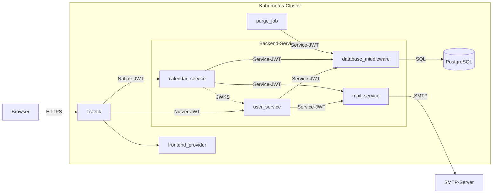

# Architektur

Bei My Dostors Date handelt es sich um eine Go-Web-Applikation, die in Microservices aufgeteilt ist.
Dabei wurde folgende Aufteilung umgesetzt:

* Kalendar-Dienst (`calendar_service`): Verwaltung der Termine.
* Nutzer-Dienst (`user_service`): Verwaltung der Nutzerdaten.
* Mail-Dienst (`mail_service`): Schreiben von E-Mails.
* Datenbank-Schnittstelle (`database_middleware`): Zentrale Kommunikationsschnittstelle zur Datenbank.

Diese Aufteilung erlaubt eine feingranulare Aufgabenverteilung, ermöglicht Wachstum und vergrößert die Sicherheit.

Grundsätzlich wurde sich für Go entschieden, da...

* Standardbibliotheken vorhanden sind,
* Zusammenarbeit mit Docker einfach ist durch die einzelnen unabhängigen Go Binaries,
* out-of-the-box Werkzeuge existieren zum Formatieren, Linting und Testing und
* keine eigene Speicherbehandlung umgesetzt werden muss.

Erwägte Alternativen waren Python und Java, jedoch ist hier der Initialisierungsaufwand größer und der Funktionsumfang
eingeschränkter.

## Security Requirements

| ID                 | SR.01                                                                                                                                       |
|--------------------|---------------------------------------------------------------------------------------------------------------------------------------------|
| Name               | JWT Replay-Attack-Prävention                                                                                                                |
| Beschreibung       | Verwendete JWT tokens eines Issuers müssen zwischengespeichert werden, um zu verhindern, dass sie von diesem wiederverwendet werden können. |
| Kategorie          | Authentifizierung (Service-Service)                                                                                                         |
| Schutzziel         | Vertraulichkeit und Integrität                                                                                                              |
| Geltungsbereich    | Jede Service2Service-Kommunikation                                                                                                          |
| Akzeptanzkriterium | Geteilte JWT lib erkennt wiederverwendung eines Tokens eines Services.                                                                      |

| ID                 | SR.02                                                                        |
|--------------------|------------------------------------------------------------------------------|
| Name               | Nutzer-JWT Gültigkeitszeitraum                                               |
| Beschreibung       | Ein Nutzer-JWT sollte nur 15 Minuten gültig sein ohne Erneuerungsoption.     |
| Kategorie          | Authentifizierung (User-Service)                                             |
| Schutzziel         | Vertraulichkeit und Integrität                                               |
| Geltungsbereich    | Jede USer2Service-Kommunikation                                              |
| Akzeptanzkriterium | Nutzer-JWT hat einen nicht erweiterbaren Gültigkeitszeitraum von 15 Minuten. |

| ID                 | SR.03                                                                                                                                                                                                                                   |
|--------------------|-----------------------------------------------------------------------------------------------------------------------------------------------------------------------------------------------------------------------------------------|
| Name               | Zentraler Datenbankzugriff                                                                                                                                                                                                              |
| Beschreibung       | Der Datenbankzugriff ist nur über die Middleware (`database_middleware`) möglich.                                                                                                                                                       |
| Kategorie          | Zugriffskontrolle                                                                                                                                                                                                                       |
| Schutzziel         | Vertraulichkeit und Integrität                                                                                                                                                                                                          |
| Geltungsbereich    | Jeder Zugriff auf die Datenbank, d. h. alle Services außer `database_middleware`                                                                                                                                                        |
| Akzeptanzkriterium | Ausschließlich `database_middleware` besitzt Datenbank-Zugangsdaten und hat Netzwerkzugriff auf die Datenbank. Alle anderen Services greifen nur über deren authentifizierte API zu (Service-JWT, Aufrufer laut Autorisierungstabelle). |

| ID                 | SR.04                                                                                                                                                                                                                       |
|--------------------|-----------------------------------------------------------------------------------------------------------------------------------------------------------------------------------------------------------------------------|
| Name               | Zentraler und template-gestützter E-Mail-Versand                                                                                                                                                                                                     |
| Beschreibung       | E-Mail-Versand ist nur über `mail_service` möglich und dieser nutzt nur vorgefertigte E-Mails (Templates).                                                                                                                  |
| Kategorie          | Eingabevalidierung                                                                                                                                                                                                          |
| Schutzziel         | Integrität und Verfügbarkeit                                                                                                                                                                                                |
| Geltungsbereich    | Jeder E-Mail-Versand, d. h. `mail_service` und alle Aufrufer (`user_service`, `calendar_service`)                                                                                                                           |
| Akzeptanzkriterium | SMTP-Zugangsdaten liegen nur im `mail_service`. Der Versand ist nur für authentifizierte, in der Autorisierungstabelle erlaubte Services möglich und nur für registrierte Templates. Freie Inhalte werden nicht akzeptiert. |

| ID                 | SR.05                                                                                                                                                                                                 |
|--------------------|-------------------------------------------------------------------------------------------------------------------------------------------------------------------------------------------------------|
| Name               | Links in E-Mails                                                                                                                                                                                      |
| Beschreibung       | Links, die ein Aufrufer für ein E-Mail-Template übergibt, werden vor dem Senden geprüft. Erlaubt sind nur Links, die mit der Basis-Adresse des Frontends (`LinkBase`, aus `PUBLIC_BASE_URL`) beginnen. |
| Kategorie          | Eingabevalidierung                                                                                                                                                                                    |
| Schutzziel         | Integrität und Vertraulichkeit                                                                                                                                                                        |
| Geltungsbereich    | Der Link-Parameter (`params.link`) jedes `sendMail`-Aufrufs im `mail_service`                                                                                                                         |
| Akzeptanzkriterium | Ein übergebener Link muss mit `LinkBase` + `/` beginnen. Andernfalls wird der Aufruf mit dem Fehler `foreign_link` (Feld `params.link`) abgelehnt und keine E-Mail gesendet. Ein kompromittierter Aufrufer kann so keine Links auf fremde Domains einschleusen. |

| ID                 | SR.06                                                                                                                                                                                                 |
|--------------------|-------------------------------------------------------------------------------------------------------------------------------------------------------------------------------------------------------|
| Name               | Kubernetes Profilkonfiguration                                                                                                                                                                                      |
| Beschreibung       | Die Pod Security Admission soll auf `restricted` gesetzt sein, s.d. jeder Pod, der mit Root-Rechten läuft, abgelehnt wird.  |
| Kategorie          | Deployment                                                                                                                                                                                    |
| Schutzziel         |                                                                                                                                                                         |
| Geltungsbereich    | Im kompletten Namespace.                                                                                                                        |
| Akzeptanzkriterium | `namespace.yaml` setzt `pod-security.kubernetes.io/enforce: restricted`. |

## Architekturdiagramm

