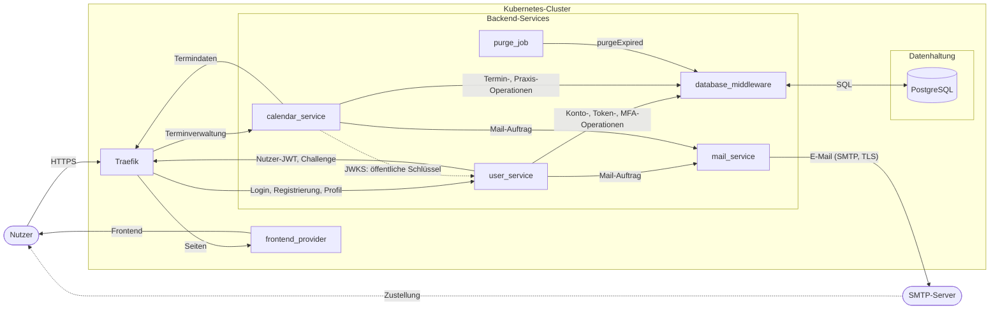

# Datenfluss

## DFD

## STRIDE

### Komponenten

#### Traefik

| STRIDE                     | Bedrohung                          | Beschreibung                                                           | Beispielangriff                                     | Voraussetzungen                  | Gegenmaßnahmen                                                                           | Status        |
|----------------------------|------------------------------------|------------------------------------------------------------------------|-----------------------------------------------------|----------------------------------|------------------------------------------------------------------------------------------|---------------|
| **S**poofing               | Gefälschter Ingress                | Angreifer gibt sich als Traefik aus und spricht Services direkt an     | Direkter Aufruf von `user_service`                  | Netzwerkzugriff im Cluster       | NetworkPolicy, Services vertrauen nicht auf Header, sondern auf JWT                      | Implementiert |
| **T**ampering              | Manipulierte Routing-Konfiguration | Routen werden verändert, interne Endpunkte werden veröffentlicht       | `/v1/jwks` oder `/healthz` wird nach außen geroutet | Schreibzugriff auf Konfiguration | Konfiguration versioniert, interne Routen (`access: internal`) nicht routen              | Implementiert |
| **R**epudiation            | Fehlende Zugriffslogs              | Anfragen sind nicht nachvollziehbar                                    | Angriff ohne Spur                                   | Access-Log ausgeschaltet         | Access-Log mit Request-ID, ohne Tokens und Query-Secrets                                 | Offen         |
| **I**nformation disclosure | Unverschlüsselter Verkehr          | Zugangsdaten und Gesundheitsdaten im Klartext                          | Mitlesen im WLAN                                    | HTTP zugelassen                  | TLS erzwingen, HSTS, HTTP-Weiterleitung                                                  | Implementiert |
| **D**enial of service      | Überlastung am Eingang             | Flut von Anfragen legt alle Dienste lahm                               | Request-Flood auf `/v1/auth/login`                  | Öffentliche Erreichbarkeit       | Rate-Limit am Ingress und je Route, Timeouts, Größenlimits             | Offen         |
| **E**levation of privilege | Zugriff auf interne Dienste        | Angreifer erreicht `database_middleware` oder `mail_service` von außen | Route auf internen Dienst                           | Fehlkonfiguration                | Nur `user_service`, `calendar_service` und `frontend_provider` sind Ziele; NetworkPolicy | Implementiert |

- Fehlende Zugriffslogs: Die Dienste loggen ihre Zugriffe selbst, und eine gemeinsame Request-ID würde Änderungen in Frontend und allen Backends verlangen.
- Überlastung am Eingang: Rate-Limits findet in die Dienste statt

#### frontend_provider

| STRIDE                     | Bedrohung                             | Beschreibung                                                 | Beispielangriff                   | Voraussetzungen                     | Gegenmaßnahmen                                                                           | Status        |
|----------------------------|---------------------------------------|--------------------------------------------------------------|-----------------------------------|-------------------------------------|------------------------------------------------------------------------------------------|---------------|
| **S**poofing               | Gefälschtes Frontend                  | Nutzer erhält eine Seite von einem anderen Server (Phishing) | Nachgebaute Login-Seite           | Nutzer prüft Domain nicht           | Feste Domain, HSTS, E-Mail-Links nur auf `LinkBase`                            | Implementiert |
| **T**ampering              | Manipulierte Auslieferung             | Schadcode wird in Seiten oder Assets eingeschleust           | Kompromittierte Abhängigkeit, XSS | Unsichere Build-Kette, fehlende CSP | Content-Security-Policy, gepinnte Abhängigkeiten, Template-Escaping                      | Implementiert |
| **R**epudiation            | Aktionen im Frontend nicht zuordenbar | Anfragen lassen sich nicht einem Nutzer zuordnen             | Abstreiten einer Terminänderung   | Keine Request-ID                    | Request-ID durchreichen, Logging im jeweiligen Backend                                   | Offen         |
| **I**nformation disclosure | Token im Zugriff von Skripten         | JWT wird per JavaScript gestohlen                            | XSS liest Token                   | Token in `localStorage`             | JWT nur als HttpOnly-, Secure-, SameSite=Strict-Cookie                                   | Implementiert |
| **D**enial of service      | Überlastung der Auslieferung          | Seitenaufrufe belegen Ressourcen                             | Massenabruf                       | Keine Drosselung                    | Rate-Limit am Ingress, statische Auslieferung, Caching                                   | Offen         |
| **E**levation of privilege | Frontend-Check statt Server-Check     | Rollen werden nur im Browser geprüft                         | Manipulierte Rollenanzeige        | Fehlende Prüfung im Backend         | Autorisierung ausschließlich im Backend (deny by default), CSRF-Schutz                   | Implementiert |

- Aktionen nicht zuordenbar: Es gibt noch keine Request-ID, siehe "Fehlende Zugriffslogs“.
- Überlastung der Auslieferung: Siehe "Überlastung am Eingang“, der Pod hat nur Ressourcenlimits.

#### user_service

| STRIDE                     | Bedrohung                                | Beschreibung                                                                                | Beispielangriff                                         | Voraussetzungen                                            | Gegenmaßnahmen                                                                                                                                        | Status             |
|----------------------------|------------------------------------------|---------------------------------------------------------------------------------------------|---------------------------------------------------------|------------------------------------------------------------|-------------------------------------------------------------------------------------------------------------------------------------------------------|--------------------|
| **S**poofing               | Identitätsdiebstahl bei Anmeldung        | Angreifer meldet sich als anderer Nutzer an                                                 | Credential-Stuffing, Brute Force auf Passwort oder TOTP | Öffentliche Login-Route, schwache oder geleakte Passwörter | Zweistufiger Login mit Pflicht-MFA, Argon2id, Passwort-Blocklist, Sperre nach Fehlversuchen, Rate-Limit, gleiche Antwort für alle Fehlerfälle | Implementiert      |
| **T**ampering              | Manipuliertes oder wiederverwendetes JWT | Angreifer ändert oder wiederholt Tokens                                                     | `alg=none`, abgelaufenes oder fremd signiertes Token    | Unsichere Validierung                                      | EdDSA fest                   | Implementiert      |
| **R**epudiation            | Admin-Aktionen nicht nachvollziehbar     | Rollenänderung oder Entsperrung lässt sich abstreiten                                       | Admin ändert Rollen ohne Spur                           | Fehlendes Audit-Log                                        | Audit-Eintrag je Admin-Aktion über `database_middleware`, `act` im Service-JWT                                                                        | Implementiert      |
| **I**nformation disclosure | Konto-Enumeration und Datenleck          | Antworten verraten, ob ein Konto existiert; Hashes oder MFA-Geheimnisse gelangen nach außen | Registrierung mit bekannter E-Mail, Fehlermeldungen     | Unterschiedliche Antworten                                 | Neutrale Antworten (202, `invalid_credentials`), MFA-Geheimnis verschlüsselt, keine Geheimnisse in Logs                                               | Implementiert      |
| **D**enial of service      | Sperren fremder Konten                   | Absichtlich falsche Anmeldungen sperren Nutzer                                              | Gezielte Fehlversuche gegen eine E-Mail                 | Sperre je E-Mail                                           | Zeitlich begrenzte Sperre, Entsperrung durch Admin, Rate-Limit je Client                                                                              | Teil-Implementiert |
| **E**levation of privilege | Rollenausweitung                         | Nutzer ändert eigene Rollen oder Daten fremder Nutzer                                       | Manipulierte `roles` oder fremde `sub`                  | Fehlende Autorisierung                                     | `sub` und `roles` nur aus dem signierten Token, Rollenprüfung nach `authorization.yaml` (deny by default), Eigentümerprüfung (404 statt 403)          | Implementiert      |

- Sperren fremder Konten: Die Kontosperre schützt gegen Brute Force. Dass Fremde ein Konto sperren können, wird in Kauf genommen, der Admin kann entsperren.

#### calendar_service

| STRIDE                     | Bedrohung                               | Beschreibung                                    | Beispielangriff                                    | Voraussetzungen            | Gegenmaßnahmen                                                                                       | Status             |
|----------------------------|-----------------------------------------|-------------------------------------------------|----------------------------------------------------|----------------------------|------------------------------------------------------------------------------------------------------|--------------------|
| **S**poofing               | Gestohlenes oder gefälschtes Nutzer-JWT | Angreifer handelt als anderer Nutzer            | Wiederverwendung eines gestohlenen Tokens          | Token abgegriffen          | Kurze Gültigkeit, `tokenCheck` bei jeder Anfrage, HttpOnly-Cookie                                    | Implementiert      |
| **T**ampering              | Manipulation von Terminen               | Termin wird fremd geändert oder doppelt gebucht | Änderung einer fremden Buchungs-ID, Race Condition | Fehlende Eigentümerprüfung | Eigentümer-Filter als Parameter der DB-Operation, Exclusion Constraint gegen Überschneidung          | Implementiert      |
| **R**epudiation            | Terminänderungen nicht nachvollziehbar  | Absage oder Änderung lässt sich abstreiten      | Rezeption storniert Termin ohne Spur               | Fehlende Protokollierung   | Statushistorie über `bookings`, Audit nur ohne Termininhalt, Bestätigungs-Mail                       | Teil-Implementiert |
| **I**nformation disclosure | Einsicht in fremde Termine              | Gesundheitsbezogene Daten gelangen an Unbefugte | Aufruf fremder Buchungs-IDs (IDOR)                 | Fehlende Eigentümerprüfung | Rollen- und Eigentümerprüfung, 404 statt 403, keine Terminhinweise in Mails                          | Implementiert      |
| **D**enial of service      | Slot-Blockade                           | Angreifer bucht massenhaft Termine              | Automatisierte Buchungen                           | Offene Buchung             | Rate-Limit je Nutzer, Limit offener Buchungen                                                        | Teil-Implementiert |
| **E**levation of privilege | Aktionen ohne Berechtigung              | Patient führt Arzt- oder Rezeptionsaktionen aus | Aufruf von `serviceCreate` als Patient             | Fehlende RBAC              | Strikte RBAC laut `authorization.yaml`, kein Zugriff auf Passwort-Hash oder MFA in der DB-Allow-List | Implementiert      |

- Terminänderungen nicht nachvollziehbar: Das Audit-Log enthält bewusst keine Termininhalte, der Systemadmin darf keine Termindaten sehen, und stornierte Termine werden nach Frist A ohnehin gelöscht.
- Slot-Blockade: Stornierungen vom Admin und Sperren von Nutzern ist jederzeit möglich, blockierte Slots werden schnell wieder frei

#### mail_service

| STRIDE                     | Bedrohung                          | Beschreibung                                                | Beispielangriff                                            | Voraussetzungen             | Gegenmaßnahmen                                                                                                    | Status             |
|----------------------------|------------------------------------|-------------------------------------------------------------|------------------------------------------------------------|-----------------------------|-------------------------------------------------------------------------------------------------------------------|--------------------|
| **S**poofing               | Gefälschter Aufrufer               | Ein Angreifer sendet Mails im Namen eines Dienstes          | Eigenes Token mit `iss=user_service`                       | Zugriff auf das Netz        | Prüfung des Service-JWT (Signatur, `aud`, `exp`, Replay-Cache), Aufrufer-Allow-List je Template                   | Implementiert      |
| **T**ampering              | Manipulierter Mailinhalt           | Fremde Links oder Inhalte in Mails                          | Phishing-Link in `params.link`, Header-Injection über `to` | Kompromittierter Aufrufer   | Nur registrierte Templates, exakte Parameter, Link muss mit `LinkBase` beginnen, Adressvalidierung                | Implementiert      |
| **R**epudiation            | Versand nicht nachvollziehbar      | Unklar, wer eine Mail ausgelöst hat                         | Mail-Flut ohne Zuordnung                                   | Fehlendes Logging           | `jti` und Aufrufer loggen, Fehler ohne Verbindungsdetails                                                         | Teil-Implementiert |
| **I**nformation disclosure | Leck vertraulicher Daten über Mail | Gesundheitsdaten oder SMTP-Zugangsdaten gelangen nach außen | Terminhinweis in Mailtext, SMTP-Passwort in Logs           | Freitext in Mails           | Keine Terminhinweise im Template, Zugangsdaten nur im Service, TLS zum SMTP-Server                                | Implementiert      |
| **D**enial of service      | Mail-Flut                          | Ein Postfach oder der SMTP-Server wird überlastet           | Massenversand durch kompromittierten Dienst                | Gültiges Service-Token      | Rate-Limit je Empfänger und je Aufrufer, Größenlimit für Requests, SMTP-Timeout                                   | Implementiert      |
| **E**levation of privilege | Fremdes Template                   | Ein Dienst sendet Templates des anderen Dienstes            | `calendar_service` sendet `password_reset`                 | Fehlende Template-Zuordnung | `Spec.Allowed(caller)`, `403 template_not_allowed`                                                                | Implementiert      |

- Versand nicht nachvollziehbar: Der Empfänger bleibt aus dem Log, damit dort keine Patientendaten stehen.

#### database_middleware

| STRIDE                     | Bedrohung                           | Beschreibung                                   | Beispielangriff                          | Voraussetzungen      | Gegenmaßnahmen                                                                                        | Status        |
|----------------------------|-------------------------------------|------------------------------------------------|------------------------------------------|----------------------|-------------------------------------------------------------------------------------------------------|---------------|
| **S**poofing               | Gefälschter Aufrufer                | Angreifer ruft DB-Operationen als Dienst auf   | Eigenes Token mit `iss=user_service`     | Netzwerkzugriff      | Service-JWT (EdDSA, höchstens 60 s), Replay-Cache, Public Keys aus ConfigMap                          | Implementiert |
| **T**ampering              | SQL-Injection und Datenmanipulation | Eingaben verändern Abfragen                    | Manipulierter Parameter                  | Dynamisches SQL      | Feste, parametrisierte Operationen, kein SQL oder Tabellenname im Request        , typisierte Bodys   | Implementiert |
| **R**epudiation            | Änderungen nicht nachvollziehbar    | Wer hat Daten geändert, ist unklar             | Admin ändert Rollen ohne Spur            | Fehlendes Audit      | `audit_log` mit `act` aus dem Service-JWT, nie Termininhalte                                          | Implementiert |
| **I**nformation disclosure | Zu viele Daten pro Aufrufer         | Ein Dienst liest Daten, die er nicht braucht   | `calendar_service` liest `password_hash` | Zu breite Allow-List | Allow-List je Operation (`x-allowed-callers`), geprüft durch `contractcheck`; Fehler ohne SQL-Details | Implementiert |
| **D**enial of service      | Überlastung der Datenbank           | Teure Abfragen oder große Requests             | Sehr große Listenabfrage                 | Keine Begrenzung     | Größenlimit für Requests (`MaxBytesReader`), Paginierung                                              | Implementiert |
| **E**levation of privilege | Nicht erlaubte Operation            | Ein Dienst führt Operationen eines anderen aus | `user_service` ruft `purgeExpired` auf   | Fehlende Allow-List  | Generierte Policy-Tabelle, deny by default (`403 forbidden`)                                          | Implementiert |

#### purge_job

| STRIDE                     | Bedrohung                        | Beschreibung                                       | Beispielangriff                       | Voraussetzungen       | Gegenmaßnahmen                                                                          | Status             |
|----------------------------|----------------------------------|----------------------------------------------------|---------------------------------------|-----------------------|-----------------------------------------------------------------------------------------|--------------------|
| **S**poofing               | Gefälschter Job                  | Jemand löst die Löschung mit eigenem Token aus     | Aufruf von `purgeExpired`             | Zugriff auf Netz      | Nur `purge_job` darf diese Operationen aufrufen (Allow-List), eigener Schlüssel         | Implementiert      |
| **T**ampering              | Manipulierte Löschfristen        | Fristen werden verkürzt, Daten gehen verloren      | Änderung der Tabelle `config`         | Schreibzugriff auf DB | Fristen per Migration mit Constraints (> 0), kein Schreibweg von außen                  | Teil-Implementiert |
| **R**epudiation            | Löschläufe nicht nachvollziehbar | Unklar, was gelöscht wurde                         | Streit über gelöschte Daten           | Kein Audit            | Audit-Eintrag mit Kategorie und Anzahl, ohne Inhalte                                    | Implementiert      |
| **I**nformation disclosure | Daten in Logs des Jobs           | Personenbezogene Daten tauchen im Joblog auf       | Ausgabe gelöschter Datensätze         | Ausführliches Logging | Nur Zähler loggen                                                                       | Implementiert      |
| **D**enial of service      | Hängender oder ausbleibender Job | Daten werden nicht gelöscht oder DB wird blockiert | Endlosschleife, Dauerlast             | Keine Zeitgrenze      | CronJob (`concurrencyPolicy: Forbid`, `activeDeadlineSeconds`), `RUN_TIMEOUT`; Batch-Größen und Überwachung fehlen | Teil-Implementiert |
| **E**levation of privilege | Zu weitreichende Rechte          | Der Job nutzt mehr als nötig                       | Aufruf nicht vorgesehener Operationen | Breites Token         | Allow-List nur für `purgeExpired`, `bookingsCompletePast`, `retentionGet`, `auditWrite` | Implementiert      |

- purge_job: Einmaliger Lauf als CronJob (täglich 03:17 Europe/Berlin), eigener Schlüssel `service-key-purge-job`, NetworkPolicy nur zu `database_middleware`. Der Job ruft `bookingsCompletePast` und danach `purgeExpired` je Kategorie auf; ein fehlgeschlagener Schritt stoppt die übrigen nicht, der Lauf endet dann mit Exit-Code 1.
- Manipulierte Löschfristen: Das Löschkonzept verlangt, dass der Systemadmin die Fristen ändern kann. Die Änderung wird auditiert.
- Daten in Logs des Jobs: Der Job loggt nur Schritt, Kategorie und Anzahl; Fehler enthalten nur HTTP-Status und Problem-Code.
- Hängender oder ausbleibender Job: Zeitgrenzen sind umgesetzt. Batch-Größen und Überwachung eines ausbleibenden Laufs (Alarm) fehlen noch.

#### PostgreSQL

| STRIDE                     | Bedrohung                                  | Beschreibung                                       | Beispielangriff                | Voraussetzungen                    | Gegenmaßnahmen                                                                                        | Status             |
|----------------------------|--------------------------------------------|----------------------------------------------------|--------------------------------|------------------------------------|-------------------------------------------------------------------------------------------------------|--------------------|
| **S**poofing               | Direktzugriff mit gestohlenen Zugangsdaten | Angreifer verbindet sich als `database_middleware` | Zugangsdaten aus Konfiguration | Zugangsdaten außerhalb des Secrets | Zugangsdaten nur als Secret im `database_middleware`, NetworkPolicy                                   | Implementiert      |
| **T**ampering              | Direkte Datenänderung                      | Daten werden an der Anwendung vorbei geändert      | Update auf `user_roles`        | DB-Zugriff                         | Constraints (`CHECK`, `EXCLUDE`, Fremdschlüssel), `password_hash` muss `$argon2id$` sein, Migrationen | Implementiert      |
| **R**epudiation            | Manipulierbares Audit-Log                  | Einträge werden gelöscht oder verändert            | Löschen von `audit_log`        | Schreibrechte der Anwendung        | Append-only in der Anwendung; DB-Rechte ohne UPDATE und DELETE auf `audit_log` ergänzen               | Teil-Implementiert |
| **I**nformation disclosure | Klartext in Datenbank und Backups          | Passwörter, Tokens, MFA-Geheimnisse lesbar         | Auslesen eines Backups         | Unverschlüsselte Speicherung       | Argon2id-Hashes, gehashte Tokens, verschlüsseltes `secret_enc`, Verschlüsselung der Backups           | Teil-Implementiert |
| **D**enial of service      | Ressourcenerschöpfung                      | Verbindungen oder Speicher gehen aus               | Verbindungsflut                | Keine Limits                       | Connection-Pool, Ressourcenlimits, Backups                                                            | Teil-Implementiert |
| **E**levation of privilege | Zu weitreichende DB-Rolle                  | Anwendung nutzt Superuser-Rechte                   | Schema-Änderung zur Laufzeit   | Eine Rolle für alles               | Getrennte Rollen für Migration und Laufzeit, minimale Rechte                                          | Implementiert      |

- Manipulierbares Audit-Log: Der Purge muss alte Audit-Einträge nach Frist E löschen, deshalb kann `praxis_app` DELETE nicht entzogen werden.
- Klartext in Datenbank und Backups: Backups sind eine akzeptierte Einschränkung, deshalb gibt es auch keine Backup-Verschlüsselung.
- Ressourcenerschöpfung: Backups sind eine akzeptierte Einschränkung, und ein Pool von 10 Verbindungen bei einer Replik hält die Last klein.

### Datenflüsse über Vertrauensgrenzen

#### Nutzer zu Traefik und zurück

| STRIDE                     | Bedrohung                            | Beschreibung                                     | Beispielangriff                         | Voraussetzungen                | Gegenmaßnahmen                                                           | Status             |
|----------------------------|--------------------------------------|--------------------------------------------------|-----------------------------------------|--------------------------------|--------------------------------------------------------------------------|--------------------|
| **S**poofing               | Identitätsdiebstahl                  | Angreifer nutzt fremde Zugangsdaten oder Sitzung | Credential-Stuffing, gestohlenes Cookie | Öffentliche Erreichbarkeit     | Pflicht-MFA, Rate-Limit, HttpOnly-Cookie, kurze JWT-Gültigkeit           | Implementiert      |
| **T**ampering              | Manipulierte Requests                | Anfragen werden verändert oder fremd ausgelöst   | CSRF, Man-in-the-Middle                 | Fehlendes TLS oder CSRF-Schutz | TLS, SameSite=Strict, `_csrf`-Token mit Origin-Prüfung                   | Implementiert      |
| **R**epudiation            | Anfragen abstreitbar                 | Nutzer bestreitet Aktion                         | Abstreiten einer Stornierung            | Keine Protokollierung          | Request-ID, Access-Log, Audit im Backend                                 | Teil-Implementiert |
| **I**nformation disclosure | Mitlesen von Daten                   | Zugangs- und Gesundheitsdaten im Transit         | Abhören im öffentlichen WLAN            | Klartext-HTTP                  | TLS, HSTS, Secure-Cookie, keine Token in URLs                            | Implementiert      |
| **D**enial of service      | Request-Flut                         | Dienste werden überlastet                        | Massenanfragen auf Login                | Keine Drosselung               | Rate-Limit (30/min je Client, Login 10/min je E-Mail), Timeouts          | Implementiert      |
| **E**levation of privilege | Zugriff auf nicht öffentliche Routen | Von außen werden interne Routen erreicht         | Aufruf von `/v1/jwks` oder `/healthz`   | Falsches Routing               | Interne Routen nicht routen, deny by default                             | Implementiert      |

- Anfragen abstreitbar: Es gibt noch keine Request-ID und kein Traefik-Access-Log, siehe "Fehlende Zugriffslogs“.

#### Traefik zu user_service

| STRIDE                     | Bedrohung                   | Beschreibung                                  | Beispielangriff                                           | Voraussetzungen        | Gegenmaßnahmen                                                                      | Status             |
|----------------------------|-----------------------------|-----------------------------------------------|-----------------------------------------------------------|------------------------|-------------------------------------------------------------------------------------|--------------------|
| **S**poofing               | Umgehung von Traefik        | Aufruf des Dienstes mit gefälschter Herkunft  | Gefälschter `X-Forwarded-For` zum Umgehen des Rate-Limits | Direkter Netzzugriff   | NetworkPolicy, Herkunft nur von Traefik vertrauen                                   | Implementiert      |
| **T**ampering              | Gefälschtes Nutzer-JWT      | Token wird verändert                          | `alg=none`, geänderte `roles`                             | Unsichere Validierung  | Zentrale Verifikation in `libs/auth` (nur EdDSA, `kid`, `iss`, `aud`, `exp`)        | Implementiert      |
| **R**epudiation            | Login nicht nachvollziehbar | Anmeldeversuche lassen sich nicht zuordnen    | Abstreiten einer Anmeldung                                | Fehlende Logs          | Protokoll von Erfolg und Fehlschlag ohne Passwörter, optional `login_warning`       | Teil-Implementiert |
| **I**nformation disclosure | Leck in Antworten           | Fehlermeldungen oder Token gelangen an Dritte | Unterschiedliche Fehler für bekannte E-Mail               | Detaillierte Fehler    | Neutrale Antworten, MFA-Challenge einmalig und 5 min gültig, Cookie-Attribute       | Implementiert      |
| **D**enial of service      | Login-Flut                  | Anmeldedienst wird blockiert                  | Massenhafte Hash-Berechnung (Argon2id)                    | Öffentliche Route      | Rate-Limit je Client und E-Mail, Größenlimit für Requests                           | Implementiert      |
| **E**levation of privilege | Token mit falschem Scope    | `scope=setup` wird für volle Rechte genutzt   | Aufruf von `/v1/me` PATCH mit Setup-Token                 | Fehlende Scope-Prüfung | `scope` und `mfa` werden je Route geprüft, nur markierte Routen akzeptieren `setup` | Implementiert      |

- Login nicht nachvollziehbar: Die Login-Mail ist optional und standardmäßig aus, weil eine Mail je Login nur Rauschen wäre.

#### Traefik zu calendar_service

| STRIDE                     | Bedrohung                         | Beschreibung                              | Beispielangriff                                    | Voraussetzungen            | Gegenmaßnahmen                                                     | Status             |
|----------------------------|-----------------------------------|-------------------------------------------|----------------------------------------------------|----------------------------|--------------------------------------------------------------------|--------------------|
| **S**poofing               | Gestohlenes Nutzer-JWT            | Angreifer handelt als Nutzer              | Wiederverwendung eines abgegriffenen Cookies       | Cookie-Diebstahl           | Kurze Gültigkeit, `tokenCheck`, HttpOnly                           | Implementiert      |
| **T**ampering              | Manipulation von Terminparametern | IDs oder Zeiten werden verändert          | Fremde Buchungs-ID, Zeit außerhalb der Arbeitszeit | Fehlende Validierung       | Schema-Validierung, Eigentümer- und Rollenprüfung, DB-Constraints  | Implementiert      |
| **R**epudiation            | Terminaktionen abstreitbar        | Stornierung oder Änderung bestritten      | Rezeption bestreitet Absage                        | Fehlende Spur              | Statusverlauf, Bestätigungs-Mail, Request-ID                       | Teil-Implementiert |
| **I**nformation disclosure | Fremde Termindaten                | Einsicht durch IDOR oder Fehlermeldungen  | Durchzählen von Buchungs-IDs                       | Fehlende Eigentümerprüfung | Eigentümer-Filter, 404 statt 403, UUIDs                            | Implementiert      |
| **D**enial of service      | Buchungs-Flut                     | Slots werden massenhaft belegt            | Skript bucht alle Termine                          | Offene Buchung             | Rate-Limit je Nutzer (10/min für sensible Routen), Limits je Konto | Teil-Implementiert |
| **E**levation of privilege | Fremde Rollenaktionen             | Patient nutzt Arzt- oder Admin-Funktionen | Aufruf von `serviceDelete`                         | Fehlende Rollenprüfung     | Rollenmatrix aus `authorization.yaml`, deny by default             | Implementiert      |

- Terminaktionen abstreitbar: Siehe "Terminänderungen nicht nachvollziehbar“ und "Fehlende Zugriffslogs“.
- Buchungs-Flut: Siehe „Slot-Blockade“, die 10/min für sensible Routen gelten nur für Passwort, E-Mail, MFA und Löschung.

#### database_middleware zu PostgreSQL

| STRIDE                     | Bedrohung                         | Beschreibung                                       | Beispielangriff                         | Voraussetzungen             | Gegenmaßnahmen                                           | Status             |
|----------------------------|-----------------------------------|----------------------------------------------------|-----------------------------------------|-----------------------------|----------------------------------------------------------|--------------------|
| **S**poofing               | Gefälschter DB-Server oder Client | Verbindung zu falscher Datenbank oder Fremdzugriff | DNS-Umleitung, Nutzung der Zugangsdaten | Keine Zertifikatsprüfung    | TLS mit Zertifikatsprüfung, Secret, NetworkPolicy        | Implementiert      |
| **T**ampering              | SQL-Injection                     | Eingaben verändern Abfragen                        | Manipulierter Filterwert                | Dynamisches SQL             | Parametrisierte Abfragen (`$1`, `$2`), feste Operationen | Implementiert      |
| **R**epudiation            | Änderungen ohne Spur              | Datenänderungen sind nicht zuordenbar              | Löschung ohne Audit                     | Fehlendes Audit             | `audit_log` mit Akteur, `act` aus dem Service-JWT        | Implementiert      |
| **I**nformation disclosure | Mitlesen der DB-Verbindung        | Daten im Klartext im Netz                          | Sniffing im Cluster                     | Unverschlüsselte Verbindung | TLS zur Datenbank, minimale Rechte                       | Implementiert      |
| **D**enial of service      | Verbindungs- und Abfragelast      | Datenbank wird blockiert                           | Parallele schwere Abfragen              | Keine Limits                | Connection-Pool, Statement-Timeouts, Paginierung         | Teil-Implementiert |
| **E**levation of privilege | Zu hohe DB-Rechte                 | Kompromittierter Dienst hat volle DB-Rechte        | Schema ändern oder Daten löschen        | Superuser-Rolle             | Rolle mit minimalen Rechten, Migrationen getrennt        | Implementiert      |

- Verbindungs- und Abfragelast: Die Abfragen sind fest und parametrisiert, und Listen sind auf höchstens 200 Einträge begrenzt.

#### mail_service zu SMTP-Server

| STRIDE                     | Bedrohung                    | Beschreibung                                 | Beispielangriff                             | Voraussetzungen          | Gegenmaßnahmen                                                                                                   | Status        |
|----------------------------|------------------------------|----------------------------------------------|---------------------------------------------|--------------------------|------------------------------------------------------------------------------------------------------------------|---------------|
| **S**poofing               | Gefälschter SMTP-Server      | Mails gehen an einen Angreifer               | Umleitung in der Konfiguration              | Keine Zertifikatsprüfung | `SMTP_TLS=starttls` oder `tls` mit Zertifikatsprüfung                                                            | Implementiert |
| **T**ampering              | Manipulierte Mail im Transit | Inhalt oder Empfänger werden verändert       | Man-in-the-Middle                           | Klartext-Verbindung      | TLS, Zugangsdaten nur über TLS, `none` nur für lokale Entwicklung                                                | Implementiert |
| **R**epudiation            | Versand nicht belegbar       | Unklar, ob und an wen gesendet wurde         | Streit über zugestellte Mail                | Kein Log                 | Versand-Log ohne Inhalt, `Auto-Submitted`-Header                                                                 | Implementiert |
| **I**nformation disclosure | Mitlesen der Mail            | Links mit Einmal-Token werden abgefangen     | Abhören der Verbindung, Weitergabe der Mail | Klartext-Transport       | TLS, Einmal-Token mit kurzer Gültigkeit, keine Terminhinweise im Text                                            | Implementiert |
| **D**enial of service      | Blockade des Versands        | SMTP-Server nicht erreichbar oder überlastet | Mail-Flut                                   | Keine Limits             | Rate-Limits je Empfänger und Aufrufer, Timeout (15 s), `502 smtp_failed` ohne Wiederholung mit geändertem Inhalt | Implementiert |
| **E**levation of privilege | Missbrauch als Mail-Relay    | Der Dienst versendet beliebige Mails         | Freitext oder fremde Empfänger              | Offene Schnittstelle     | Nur Templates, festes Absenderprofil, Adressvalidierung                                                          | Implementiert |

#### SMTP-Server zu Nutzer

| STRIDE                     | Bedrohung                        | Beschreibung                                                                                         | Beispielangriff                                                       | Voraussetzungen                             | Gegenmaßnahmen                                                                                                   | Status                |
|----------------------------|----------------------------------|------------------------------------------------------------------------------------------------------|-----------------------------------------------------------------------|---------------------------------------------|------------------------------------------------------------------------------------------------------------------|-----------------------|
| **S**poofing               | Ähnliche Domain                  | Angreifer registriert eine Domain, die der der Praxis ähnlich sieht, und schreibt Patienten von dort | Mail von `praxis-muster.de` mit Link auf eine nachgebaute Login-Seite | Patient prüft Absender und Link nicht genau | Nutzer aufklären, dass nur Mails nach Anfrage kommen. Niemals reagiere auf zufällige Passwort-Zurücksetzen-Mails | nicht implementierbar |
| **T**ampering              | Manipulierter Link in der Mail   | Link führt zu Seite mit anderen Domain                                                               | Setzen über einen gekaperten Service                                  | Angreifer hat Zugriff auf einen Service     | Links nur auf `LinkBase` erlauben                                                                                | Implementiert         |
| **R**epudiation            | Zustellung nicht belegbar        | Nutzer bestreitet Erhalt                                                                             | Streit über Terminbestätigung                                         | Keine Zustellprotokolle                     | Versandprotokoll                                                                                                 | Implementiert         |
| **I**nformation disclosure | Vertrauliche Inhalte im Postfach | Dritte mit Zugriff auf Patienten-Mail lesen mit                                                      | Mitlesen                                                              | Unsichere oder geteilte Mail-Konten         | Datensparsamkeit                                                                                                 | Implementiert         |
| **D**enial of service      | Postfach-Flut                    | Ein Nutzer wird mit Mails überschüttet                                                               | Wiederholtes "Passwort vergessen“                                     | Öffentliche Route                           | Rate-Limit je Empfänger (10/min)                                                                                 | Implementiert         |
| **E**levation of privilege | Kontoübernahme über Mail         | Mit abgefangenem Link wird ein Konto übernommen                                                      | Reset-Link aus fremdem Postfach                                       | Zugriff auf Postfach                        | Einmal-Token, nach Reset Sitzungen ungültig, MFA bleibt aktiv                                                    | Implementiert         |

- Ähnliche Domain: Dieser Angriff ist eher ein Social-Engineering-Angriff und kann kaum (außer Warnungen in Mails und
  auf der Webseite) technisch gemindert werden.
