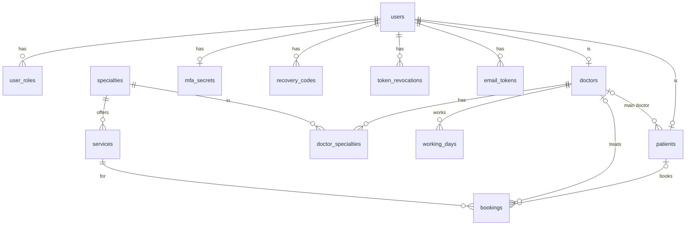

# Data model

PostgreSQL 18. Migrations: `services/database_middleware/migrations` (golang-migrate, `NNNN_name.up.sql` / `.down.sql`). Only `database_middleware` talks to the database (SR.02). Verify with `make migrate-test` (up, down, up, plus `scripts/test-schema.sql`).

## ER diagram



`config` and `audit_log` have no foreign keys: `audit_log` must survive the final deletion of a user.

## Tables

| Table | Purpose | Key constraints |
|-|-|-|
| `users` | Every person (all roles). | `lower(email)` unique; `password_hash` must start with `$argon2id$` (SR.01); `status` in `pending, active, locked, disabled`; SR.05 columns `failed_attempts`, `locked_until`, `permanently_locked`; `must_change_password` (UF-03); `sessions_valid_after` (tokens issued before it are invalid, decision 12); `deleted_at` |
| `user_roles` | Roles per user (decision 3). "Nutzer" is implicit. | PK `(user_id, role)`; role in `patient, doctor, desk, organisator, systemadmin` |
| `patients` | Patient data. | address columns; nullable `main_doctor_id` (NULL = union of matching doctors, UF-05 case B) |
| `doctors` | Doctor profile. | PK = `users.id` |
| `specialties`, `doctor_specialties` | Fachbereiche. | name unique |
| `working_days` | Arbeitszeit/Arbeitstag. | `weekday` 1 to 7 (ISO), `end_time > start_time`, several blocks per day allowed |
| `services` | Leistungsangebot. | `duration_minutes` 5 to 480, default 60; exactly one `is_other` row ("Sonstiges"); non-"other" services need a specialty |
| `bookings` | Appointments. | `ends_at > starts_at`; `status` in `angefragt, bestaetigt, storniert, abgeschlossen` (default `bestaetigt`, decision 2); nullable `doctor_id`, `patient_id`, `reason`, `info`; `deleted_at`; exclusion constraint `bookings_no_doctor_overlap` |
| `mfa_secrets` | TOTP secret, stored encrypted (`secret_enc`). | one per user; `confirmed_at` is NULL until setup completes (UF-04) |
| `recovery_codes` | Hashed one-time codes. | `used_at` |
| `token_revocations` | Revoked JWT `jti`s. | purged after `expires_at` |
| `email_tokens` | Verify, reset and e-mail-change tokens, hashed. | `token_hash` unique; `used_at`; `new_email` only for `email_change` |
| `audit_log` | Admin and purge events. | no appointment contents, only action, category and count |
| `config` | Retention periods A to E (decision 4). | seeded by migration `0006`, values > 0 |

### Double-booking protection

```sql
EXCLUDE USING gist (doctor_id WITH =, tstzrange(starts_at, ends_at) WITH &&)
WHERE (doctor_id IS NOT NULL AND deleted_at IS NULL AND status IN ('angefragt','bestaetigt'))
```

- The second of two overlapping bookings fails with SQLSTATE `23P01`; the middleware maps it to `409`.
- A cancelled or soft-deleted booking frees the slot. Adjacent bookings (end = next start) are allowed.
- **Limitation:** a "Sonstiges" booking has no doctor and is not covered. The constraint applies when reception assigns a doctor with an `UPDATE`, which then fails with `23P01` if the doctor is busy (UF-06 error case).

## Löschkonzept mapping

| Category | Column / table | Purge operation (Phase 2/5) |
|-|-|-|
| Booking cancelled or changed (A) | `bookings.status = 'storniert'`, `deleted_at`, `reason`/`info` set to NULL on cancel | `purge_expired('bookings_cancelled')` after `retention_a_days` |
| Booking completed (B, C) | `bookings.status = 'abgeschlossen'`, `ends_at` | `reason`/`info` emptied after `retention_b_days`, row deleted after `retention_c_days` |
| User account (D) | `users.status = 'disabled'`, `deleted_at`, personal fields pseudonymised; `bookings.patient_id` set to NULL | `purge_expired('users')` after `retention_d_days` |
| Sessions, tokens | `token_revocations.expires_at` | `purge_expired('tokens')` daily |
| MFA data | `mfa_secrets`, `recovery_codes` | hard-deleted immediately on MFA reset or account deletion |
| Audit log (E) | `audit_log.occurred_at` | `purge_expired('audit_log')` after `retention_e_days` |
| E-mail verify and reset tokens | `email_tokens.expires_at`, `used_at` | deleted when used or expired |

Each purge run writes one `audit_log` row (`action`, `data_category`, `affected_count`).

## Retention defaults

| Key | Days | Reason |
|-|-|-|
| `retention_a_days` | 30 | Löschkonzept example; short window to undo mistakes |
| `retention_b_days` | 365 | Löschkonzept example (12 months) for reason/info of past visits |
| `retention_c_days` | 730 | Must be at least B; record kept a further year, then removed. Our assumption, not given in the Löschkonzept |
| `retention_d_days` | 30 | Löschkonzept example |
| `retention_e_days` | 90 | Löschkonzept example |

The middleware must validate that C >= B when the system admin changes values.

## Seed templates

`services/database_middleware/seeds/specialties.json` and `services.json` are examples in the format of the organiser's JSON import (UF-09). They are not loaded by a migration, with one exception: migration `0002_practice` creates the service "Sonstiges" (UF-06), which must always exist.

## SR mapping

- SR.01: `users.password_hash` with the `$argon2id$` check (defence in depth; hashing happens in `user_service`).
- SR.02: all access through `database_middleware`; schema has no per-service roles yet (Phase 1: NetworkPolicy, Phase 2: DB role for the middleware only).
- SR.03: ownership is by `bookings.patient_id` / `bookings.doctor_id`; identity comes from the token.
- SR.05: `failed_attempts`, `locked_until`, `permanently_locked`.
